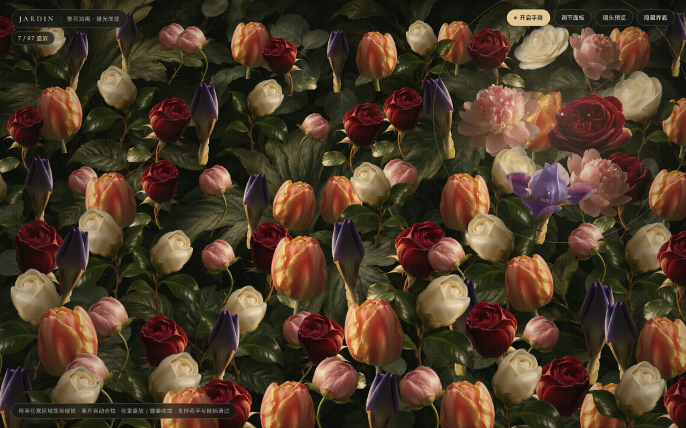
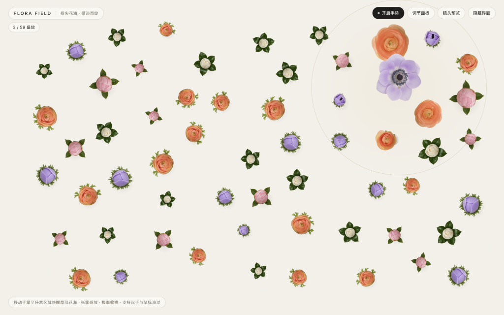
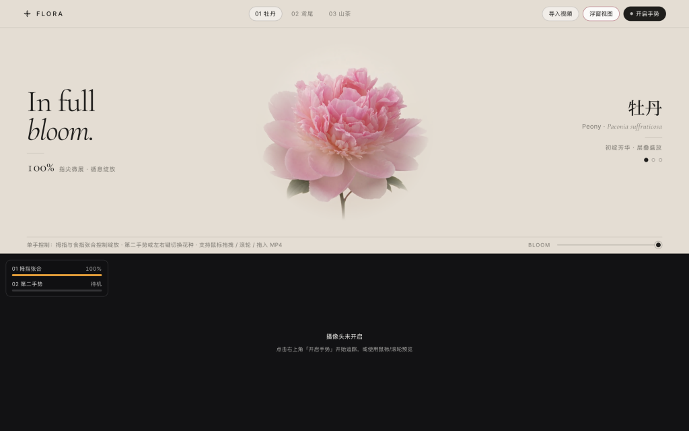
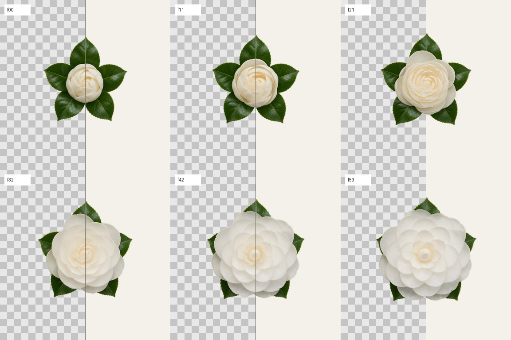
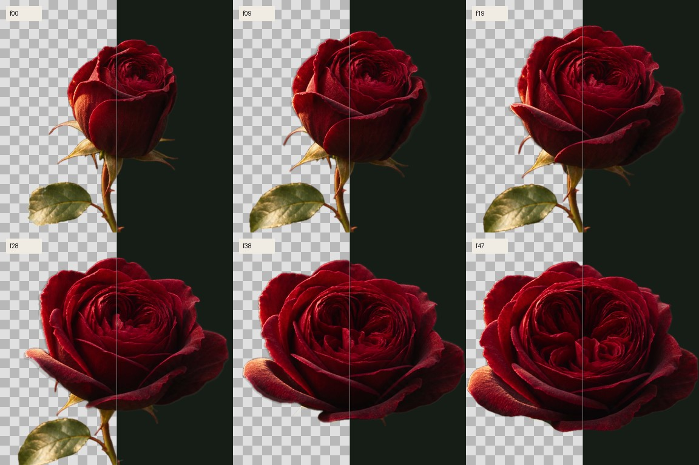

# flower-sea

**基于 AIGC 真实延时视频 + macOS Vision 神经透明抠图 + MediaPipe 本地双手空间识别的写实花卉交互合集**。

本仓库完整收录了从「单花画廊」到「全屏花海」再到「繁花油画」逐步演进的 **3 个独立可运行版本**。所有视频帧、透明花朵纹理、MediaPipe WASM 运行时与手势模型均已打包进仓库，**拉下即可本地跑通，无需翻墙、无需额外下载模型或配置后端**。

---

## 三个版本一览

| 版本 | 目录 | 视觉风格与构图 | 核心交互体验 | 默认端口 |
| :--- | :--- | :--- | :--- | :--- |
| **V3 · JARDIN（繁花油画）** | `apps/v3-jardin-oil` | 荷兰古典明暗油画底衬 + 5 种 3/4 斜面真花密铺（粉牡丹 / 丝绒玫瑰 / 金杏郁金香 / 暮紫鸢尾 / 白山茶，共 ~96 朵） | **实时跟随**（默认）：手移至任意区域即刻盛开并点亮伦勃朗追光，**离开后约 1 秒自动平滑合拢**；支持双手、握拳收拢 | `5175` |
| **V2 · FLORA FIELD（俯拍花海）** | `apps/v2-flora-field` | 浅暖画廊纸底色（`#F4F1EA`）+ 4 种 90° 俯拍透明花朵（牡丹 / 山茶 / 洋牡丹 / 银莲花），三层泊松盘铺设全屏 | **拖尾余韵**（默认）：手移走后花朵保留约 1.5–2.3 秒再错落合拢，挥手留下花浪尾迹；支持切换实时聚光灯与花海画笔 | `5174` |
| **V1 · FLORA（单花画廊）** | `apps/v1-flora-single` | 极简博物馆标本画廊排版 + 3 支高清棚拍花朵延时视频（牡丹 / 鸢尾 / 山茶，90 帧 WebP 零延迟搓帧） | 拇指与食指张合比例控制单花 0%–100% 绽放；第二只手张掌切花；支持上下分屏录屏视图与拖入自定义 MP4 | `5173` |

---

## 效果预览（Screenshots）

### V3 · JARDIN（繁花油画 · 斜面密铺 & 移开自动合拢）
> 约 96 朵 3/4 斜面花枝叠加在 2K 深翠绿油画枝叶底图上；鼠标/手掌停在右上角时局部沐浴金光盛开，移走后自动收回含苞。



### V2 · FLORA FIELD（浅暖画廊俯拍花海）
> 透明花朵在暖米白画廊纸上自由呼吸，光环所到之处花朵次第展开。



### V1 · FLORA（单花画廊 & 分屏手势 HUD）
> 复刻经典 `FLORA` 标本画廊排版与底部手部骨架遥测界面，支持 1-Euro 自适应滤波与静止防抖。



<details>
<summary>点击展开：透明抠图与序列帧质检示例（macOS Vision + 去白边/去暗边后处理）</summary>

| V2 俯拍白山茶（棋盘格 / 画廊纸对比） | V3 斜面丝绒玫瑰（棋盘格 / 暗调画布对比） |
| :---: | :---: |
|  |  |

</details>

---

## 快速启动（本地运行 3 个版本）

### 环境要求
- **Node.js 18+**（自带 `npm`）

### 1. 克隆仓库并安装依赖

```bash
git clone https://github.com/wonderful-1101/flower-sea.git
cd flower-sea

# 一次安装 3 个版本的依赖
npm run install:all

# 如果只想体验某一个版本，也可以单独安装（例如只装 V3 繁花油画）：
# npm run install:v3
```

### 2. 启动任意一个版本

```bash
# 启动 V3 · JARDIN（繁花油画） → http://localhost:5175
npm run dev:v3

# 启动 V2 · FLORA FIELD（俯拍花海） → http://localhost:5174
npm run dev:v2

# 启动 V1 · FLORA（单花画廊） → http://localhost:5173
npm run dev:v1
```

---

## 各版本交互与玩法

### V3 · JARDIN（`apps/v3-jardin-oil`）
- **摄像头手势**：点击右上角 **「开启手势」**（纯浏览器本地推理，视频流不上传服务器）；手掌移到画面任意角落即可唤醒局部花丛，**张掌盛放 / 握拳原地收拢**，手移开后原来位置的花朵会自动平滑合回花苞（支持双手同时操作两个区域）。
- **无摄像头预览**：直接用鼠标或触控在画面上移动即可唤醒局部花海；按住鼠标右键或按住 `Shift` 移动可模拟握拳收拢。
- **调节面板 & 快捷键**：点击 **「调节面板」** 可调 **响应模式**（`实时跟随` / `短暂余韵` / `油画定格`）、**手势触发**（`位置 + 张合` / `纯位置`）、绽放半径、合拢时长、花丛密度以及 `全屏盛放 / 合拢花海 / 重新排布`；支持快捷键 `H`（隐藏全部 UI）、`Space`（全屏盛放）、`Esc`（合拢）。

### V2 · FLORA FIELD（`apps/v2-flora-field`）
- **空间交互**：同样支持双手摄像头感应与鼠标/触控滑过；默认采用 **「拖尾余韵」**，手划过后花朵保持盛开约 1.5–2.3 秒再逐朵回落，适合在浅色画廊底色上划出舒缓的花浪尾迹。
- **调节面板**：支持切换 `拖尾余韵` / `实时聚光灯` / `花海画笔`、调节半径/余韵时长/花海密度以及 `H` 键隐藏界面。

### V1 · FLORA（`apps/v1-flora-single`）
- **单手控制**：摄像头前用拇指与食指张合控制花朵 `0%–100%` 绽放进度（内置 1-Euro 滤波 + 静止死区，手停稳即定格不蠕动）。
- **切花与录屏模式**：第二只手张掌保持约 0.55 秒可切换花种（也可按 `←` / `→` 或 `1`–`3` 切换）；点击 **「分屏视图」** 可切换为上下分屏录屏界面；支持直接 **拖入任意本地 MP4/WebM 视频** 自动抽帧体验。
- **无摄像头**：支持鼠标左右拖拽、滚轮或底部 `BLOOM` 滑块搓帧预览。

---

## 部署分享给别人在线体验（推荐 Vercel / Netlify）

> **重要提示（浏览器安全限制）**：浏览器仅在 `http://localhost` 或 **`https://` 安全域名**下允许调用摄像头（`getUserMedia`）。如果直接在局域网通过 HTTP IP 访问，鼠标交互正常可用，但摄像头权限会被浏览器拦截。

想把链接直接发给朋友体验摄像头手势，推荐用 **Vercel / Netlify / Cloudflare Pages** 免费部署（自带 HTTPS）：

1. 导入本 GitHub 仓库（`wonderful-1101/flower-sea`）。
2. 在平台设置 **Root Directory** 为你想部署的版本目录（推荐 `apps/v3-jardin-oil`）：
   - **Root Directory**: `apps/v3-jardin-oil`（或 `apps/v2-flora-field` / `apps/v1-flora-single`）
   - **Framework Preset**: `Vite`
   - **Build Command**: `npm run build`
   - **Output Directory**: `dist`
3. 点击 Deploy，把生成的 `https://...` 链接发给任何人即可在电脑或手机浏览器直接体验。

---

## 仓库目录结构

```text
flower-sea/
├── package.json                        # 一键安装、启动与构建 3 个版本的根脚本
├── docs/screenshots/                   # 效果截图与透明抠图质检对比图
└── apps/
    ├── v1-flora-single/                # V1 · FLORA 单花画廊（默认端口 5173）
    │   ├── src/                        # main.js / gesture.js / filters.js / frameStore.js / videoImporter.js
    │   ├── public/                     # flowers.json / 3×90 WebP 序列帧 / 原视频 / MediaPipe WASM & 模型
    │   ├── scripts/extract_frames.py   # 视频抽帧与背景色采样脚本
    │   └── assets/                     # 花苞参考图 / 原始 MP4 / 序列拼图
    ├── v2-flora-field/                 # V2 · FLORA FIELD 俯拍花海（默认端口 5174）
    │   ├── src/                        # main.js / fieldEngine.js / fieldLayout.js / gesture.js / particles.js
    │   ├── public/                     # species.json / 4×54 RGBA WebP / MediaPipe WASM & 模型
    │   ├── scripts/                    # matte_frames.swift & build_field_assets.py
    │   └── assets/                     # 俯拍花苞原图 / Seedance MP4 / 棋盘格质检图
    └── v3-jardin-oil/                  # V3 · JARDIN 繁花油画（默认端口 5175）
        ├── src/                        # main.js / tapestryEngine.js / tapestryLayout.js / gesture.js / particles.js
        ├── public/                     # bg-foliage.webp / species.json / 5×48 RGBA WebP / MediaPipe WASM & 模型
        ├── scripts/                    # matte_frames.swift & build_oil_assets.py
        └── assets/                     # 油画枝叶底图 / 斜面花苞原图 / Seedance MP4 / 暗调质检图
```

---

## 进阶：如何替换自己的花朵素材（macOS 14+）

V2 与 V3 均内置了基于 Apple Vision（`VNGenerateForegroundInstanceMaskRequest`）的自动批量抠图与时间稳定管线。以 **V3（`apps/v3-jardin-oil`）** 为例：

1. 将固定机位、纯暗色背景的俯斜花开 MP4 放入 `apps/v3-jardin-oil/assets/videos/`（对应物种名或同步调整 `build_oil_assets.py`）。
2. 安装 Python 依赖并确认系统已安装 `ffmpeg` 与 Xcode Command Line Tools：
   ```bash
   pip install numpy opencv-python scipy pillow
   ```
3. 进入目录编译 Swift 抠图器并重建透明序列帧：
   ```bash
   cd apps/v3-jardin-oil
   swiftc -O scripts/matte_frames.swift -o scripts/matte_frames
   python3 scripts/build_oil_assets.py
   ```
   脚本会自动更新 `public/sprites/`、`public/species.json`，并在 `assets/review/` 输出棋盘格与暗调画布对比质检图。
